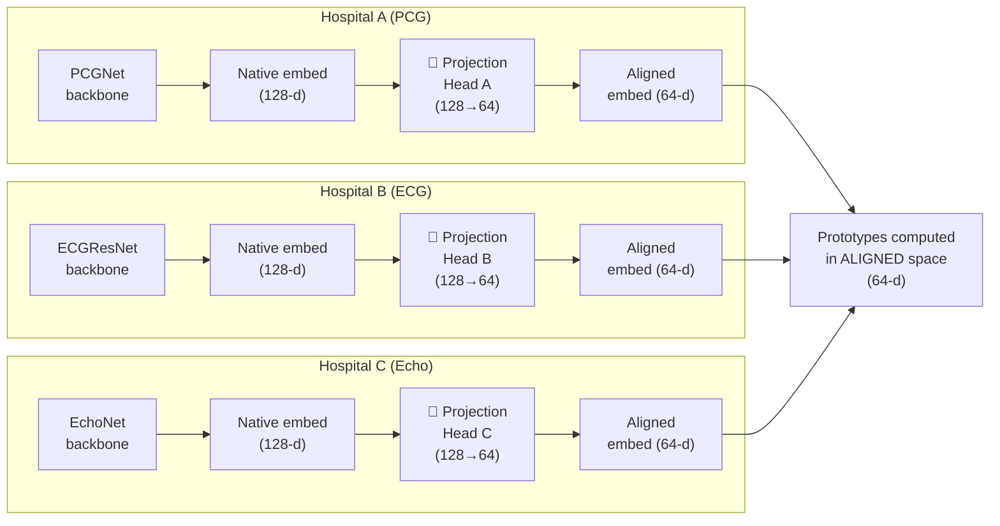

# The Embedding Alignment Problem — and How to Solve It

## You're Absolutely Right: The Problem

Your intuition is correct and this is the **most important technical challenge** in the project. Here's the problem stated precisely:

```
PCGNet    processes heart sounds  →  embedding = [0.7, -0.2, 0.4, ...]  ← means "murmur pattern"
ECGResNet processes ECG signals   →  embedding = [0.7, -0.2, 0.4, ...]  ← means "ST segment elevation"
EchoNet   processes echo frames   →  embedding = [0.7, -0.2, 0.4, ...]  ← means "reduced wall motion"
```

**Same numbers, completely different meanings.** Each model learned its own internal "language" for representing cardiac features. Averaging these vectors produces garbage — it's like averaging a Chinese sentence and an English sentence character-by-character.

> [!CAUTION]
> **Naive FedProto with raw prototype averaging across different modalities is mathematically meaningless.** This is a known limitation acknowledged in the literature, and it's exactly what MFCPL (2024), FedCMD (2025), and AproMFL (2025) were published to solve.

---

## The 3-Part Solution

### Part 1: Per-Client Projection Heads (the critical addition)

**Add a small learnable linear layer** per client that maps from the model's native 128-d embedding space into a **shared alignment space**. This projection is what translates each model's "language" into a common one.



**What each projection head does:**
- Hospital A's projection learns: *"my dimension 3 (murmur frequency) maps to shared dimension 7 (abnormality signal)"*
- Hospital B's projection learns: *"my dimension 12 (ST elevation) maps to shared dimension 7 (abnormality signal)"*  
- Hospital C's projection learns: *"my dimension 45 (wall motion) maps to shared dimension 7 (abnormality signal)"*

After projection, **dimension 7 means "abnormality signal" for ALL three models**. Now averaging makes sense.

#### Concrete Architecture Change

Each model goes from:

```
Current:   Input → Backbone → embed(128) → classifier(128→2) → logits
```

To:

```
Updated:   Input → Backbone → embed(128) → proj_head(128→64) → classifier(128→2) → logits
                                    ↓                ↓
                              (local training)  (prototype computation
                                                  happens HERE)
```

> [!IMPORTANT]
> The **classifier head still uses the 128-d native embedding** for local classification. The **projection head** is only used for computing prototypes that will be shared. This way, local model performance is not degraded by the projection.

#### Code-Level Implementation

```python
# Added to each model (tiny — just 1 linear layer per client)
class ProjectionHead(nn.Module):
    """Maps native embedding to shared alignment space."""
    def __init__(self, input_dim=128, proj_dim=64):
        super().__init__()
        self.proj = nn.Sequential(
            nn.Linear(input_dim, proj_dim),
            nn.ReLU(),
            nn.LayerNorm(proj_dim),  # normalize to unit-ish scale
        )
    
    def forward(self, embedding):
        return self.proj(embedding)  # (N, 64)
```

**Size:** 128 × 64 + 64 = **8,256 parameters**. Trivial compared to the backbone.

---

### Part 2: Iterative Co-Adaptation (how it converges)

The projection heads don't start aligned — they're randomly initialized. **The alignment emerges through iterative training.** Here's why it works:

```
Round 1:
  - All 3 hospitals compute projected prototypes (random at first)
  - Server averages them → global prototype (initially noisy)
  - Each hospital trains its projection to pull toward the global prototype
  - The 3 projections all shift slightly toward the average

Round 2:
  - Now the projected prototypes are slightly more aligned
  - Server average is slightly more meaningful
  - Each hospital adjusts further
  
Round 3...10...20:
  - The projections converge to a shared coordinate system
  - Global prototypes become semantically meaningful
  - "Normal" from all 3 modalities clusters together in the shared space
```

**Why convergence is guaranteed:** The regularization loss creates a **contraction mapping** — each round, the distance between any client's projected prototype and the global prototype shrinks. This is the same convergence mechanism proven in FedProto (Tan et al., AAAI 2022, Theorem 1).

**The key mathematical insight:** Even though the initial global prototype is "garbage" (average of random projections), it acts as an **arbitrary but consistent anchor point**. All three models are told "move toward this point for class 0, move toward that point for class 1." They don't need the anchor to be meaningful — they just need it to be *the same* for everyone. Over rounds, the anchor itself improves as the projections improve.

This is analogous to how **CLIP** (Radford et al., 2021) aligns image and text embeddings — images and text "mean" completely different things, but contrastive training creates a shared space where the same concept has nearby embeddings regardless of modality.

---

### Part 3: Contrastive Separation (optional but recommended)

Plain L2 regularization toward global prototypes only ensures same-class alignment. It doesn't ensure **different-class separation**. Add a contrastive component:

```
L_contrastive = -log(
    exp(sim(embed, global_proto_same_class) / τ) /
    [exp(sim(embed, global_proto_same_class) / τ) + 
     exp(sim(embed, global_proto_other_class) / τ)]
)
```

This is the approach from MFCPL (Le et al., 2024) and FedTGP (Zhang et al., AAAI 2024):
- **Pull** your normal embeddings toward the global normal prototype
- **Push** your normal embeddings away from the global abnormal prototype
- Vice versa for abnormal

---

## The Complete Loss Function

```python
L_total = L_CE + λ_proto * L_proto + λ_contrast * L_contrast
```

Where:

| Term | Formula | What it does |
|------|---------|-------------|
| `L_CE` | CrossEntropy(logits, labels) | Standard classification on local data |
| `L_proto` | ‖proj(embed) − G_same_class‖² | Pulls projected embeddings toward global prototype of same class |
| `L_contrast` | −log(softmax over both prototypes) | Pushes projected embeddings away from global prototype of other class |

**Hyperparameters:** `λ_proto = 0.1–1.0`, `λ_contrast = 0.01–0.1`, `τ = 0.5` (temperature)

---

## What Actually Gets Communicated

| Direction | What | Size | Notes |
|-----------|------|------|-------|
| Client → Server | 2 prototype vectors in **projected** space | 2 × 64 floats = **512 bytes** | Mean of projected embeddings per class |
| Client → Server | Sample counts per class | 2 ints = **8 bytes** | For weighted averaging |
| Server → Client | 2 global prototype vectors | 2 × 64 floats = **512 bytes** | Weighted average of all clients |
| **Total per round** | | **~1 KB per client** | vs. 1.4–44.8 MB for FedAvg |

**Privacy:** Only aggregate statistics (mean of projected embeddings) are shared. Individual patient data cannot be reconstructed from a class-mean vector.

---

## How It Maps to Your Existing Models

Your models already have the embedding interface. Here's exactly what changes:

### Current Model Forward Pass (no changes to existing code)

```python
# pcg_model.py (line 61)
def forward(self, x, return_embedding=False):
    ...
    emb = F.relu(self.fc_embed(x))    # (N, 128) ← native embedding
    logits = self.fc_out(emb)          # (N, 2)   ← classification
    if return_embedding:
        return logits, emb
    return logits
```

### What We Add (new code, doesn't touch existing)

```python
# New file: src/federation/projection.py
class ProjectionHead(nn.Module):
    def __init__(self, embed_dim=128, proj_dim=64):
        super().__init__()
        self.proj = nn.Sequential(
            nn.Linear(embed_dim, proj_dim),
            nn.ReLU(),
            nn.LayerNorm(proj_dim),
        )
    
    def forward(self, embedding):
        return self.proj(embedding)

# During federated training:
logits, native_embed = model(x, return_embedding=True)  # existing
projected = proj_head(native_embed)                       # new — for prototypes only

# Classification loss uses native logits (unchanged)
loss_ce = criterion(logits, labels)

# Prototype loss uses projected embeddings (new)
loss_proto = prototype_regularization(projected, labels, global_protos)
```

> [!TIP]
> **The classifier head still operates on the native 128-d embedding.** The projection head is a separate, parallel path used only for prototype computation. This means local classification performance is NOT degraded by the projection — it's purely additive.

---

## Paper Citations for This Exact Solution

| Paper | What it proves | Citation |
|-------|---------------|----------|
| **MFCPL** (Le et al., 2024) | Cross-modal prototype regularization with projection heads works for multimodal FL with missing modalities | arXiv:2401.13898 |
| **FedCMD** (2025) | Unimodal clients (exactly your scenario) can collaborate via prototype sharing with cross-modal alignment | ACM IMWUT, doi:10.1145/3749467 |
| **AproMFL** (Gai et al., 2025) | Adaptive prototype construction with projection for mixed modalities and heterogeneous tasks | arXiv:2502.04400 |
| **FedTGP** (Zhang et al., AAAI 2024) | Trainable global prototypes with contrastive margin prevent prototype collapse during averaging | AAAI 38(15), 16768–16776 |
| **FedProto** (Tan et al., AAAI 2022) | Foundational convergence proof for prototype-based FL across heterogeneous architectures | AAAI 36(8), 8432–8440 |
| **CreamFL** (Yu et al., ICLR 2023) | Cross-modal contrastive regularization for heterogeneous multimodal FL | ICLR 2023 |

---

## Summary: The 3-Layer Answer to Your Question

| Layer | What | Why |
|-------|------|-----|
| **1. Projection Heads** | Per-client linear layer: 128-d native → 64-d shared | Translates each model's "language" into a common coordinate system |
| **2. Iterative Alignment** | Regularization loss pulls projections toward global prototype each round | Even from random init, convergence is guaranteed because the target is shared and consistent |
| **3. Contrastive Loss** | Push different-class prototypes apart | Prevents collapse where both classes map to the same point |

**The final architecture per hospital:**

```
                                    ┌─── Projection Head ──→ projected_embed (64-d) ──→ prototypes
                                    │                                                     (shared)
Input ──→ Backbone ──→ embed (128-d) ─┤
                                    │
                                    └─── Classifier Head ──→ logits (2) ──→ local prediction
                                                                            (not shared)
```

Each model keeps its full local classification capability. The projection head is a **parallel, non-destructive addition** that creates a bridge to the shared prototype space.
